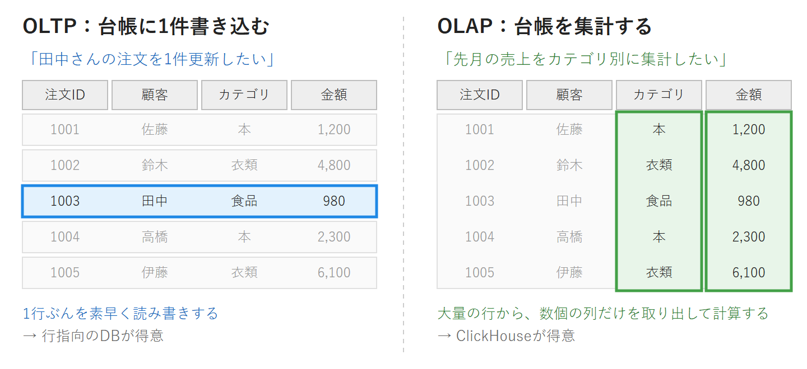
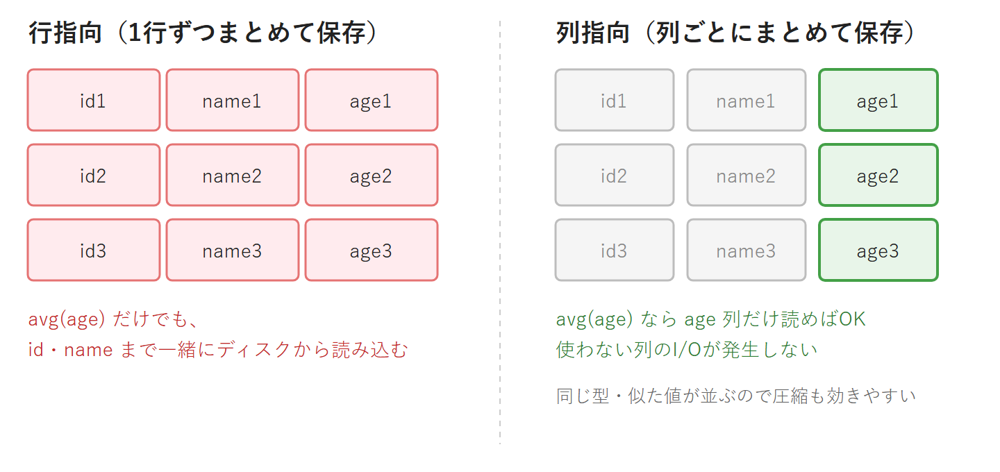
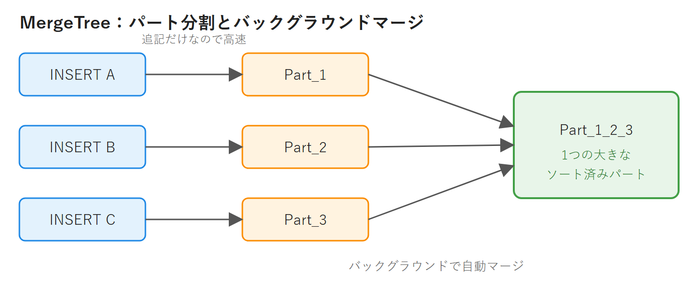
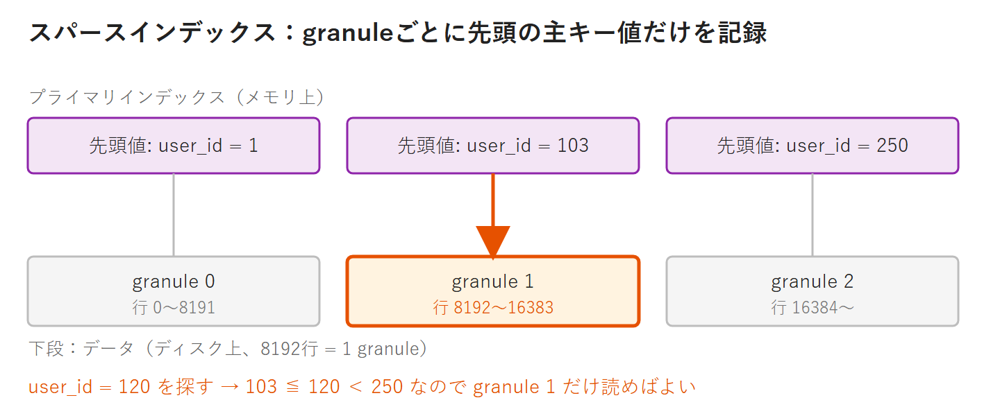
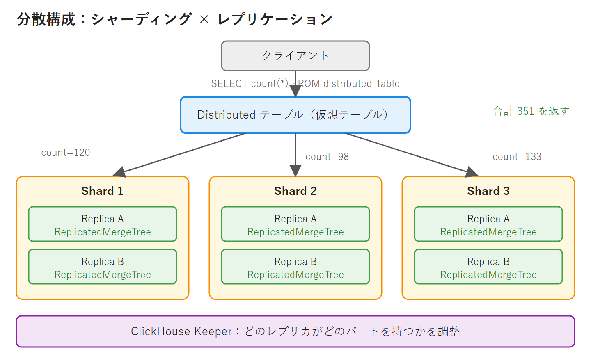

:::message
この記事でわかること：ClickHouseが集計に速い理由。列指向ストレージ、MergeTree、スパースインデックス、分散構成の順に仕組みを追います。
:::

ClickHouseが速い理由は、ほぼ「読まないデータを増やす」ことに尽きます。必要な列だけを読み、読むデータは圧縮し、検索範囲は粗い索引で絞ります。この記事では、その仕組みをストレージの持ち方から分散構成まで順に追っていきます。チューニングや監視の話はしません。

## ClickHouseとは

ClickHouseは、大量のデータを集計・分析するために作られた、オープンソースの列指向データベースです。2016年にApache 2.0ライセンスのオープンソースとして公開されました。操作にはSQLを使うので、PostgreSQLやMySQLに慣れている人なら、クエリの書き方で戸惑うことはあまりありません。

自分でサーバーやクラスタを立てて運用することも、マネージドサービスのClickHouse Cloudを使うこともできます。用途は、アクセスログやイベントの分析、ダッシュボードの集計、時系列データの分析などです。では、普通のデータベースと何が違うから、これらの集計が速いのでしょうか。まずは、ClickHouseが得意とする「仕事」の種類から見ていきます。

## ClickHouseが得意な仕事 — 台帳に書き込む仕事と、台帳を集計する仕事



MySQLやPostgreSQLのようなOLTP（Online Transaction Processing、トランザクション処理）向けのDBは、「田中さんの注文を1件更新する」といった操作が得意です。台帳の1行を、素早く読み書きできるように作られています。

ClickHouseが狙っているのは逆の仕事で、OLAP（Online Analytical Processing、分析処理）と呼ばれます。「先月の売上をカテゴリ別に集計する」ように、何百万行もの中から数個の列だけを取り出して計算します。ダッシュボードの集計やログ分析、アクセス解析が典型で、書き込みはまとめて行い、読み出しの集計は何度も走ります。この違いが、データの持ち方にそのまま出ます。

## 列ごとに保存する

行指向のDBは、1行分の値（id、name、age…）をディスク上で隣り合わせに置きます。1件を丸ごと読むなら効率がいいのですが、`SELECT avg(age) FROM users` のために age だけが欲しくても、同じ行の id や name まで読み込んでしまいます。



ClickHouseは同じ列の値をまとめて置きます。age の平均を出すなら age の列だけを読めば済み、使わない列のI/Oは起きません。テーブルの列数が多く、クエリが触る列が少ないほど、この差は大きくなります。

列ごとにまとめると、圧縮も効きます。同じ列には同じ型で似た値が並ぶので、LZ4やZSTDに加えて、連番に強いDeltaや繰り返しに強いDictionaryのような、列向けのエンコーディングを使えます。読む量が減るうえに、減った分がさらに小さくなります。この二重の効果が、集計速度の土台になっています。

## 行ごとではなく、まとめて計算する

読み込みが軽くなっても、計算が遅ければ意味がありません。従来のDBの実行エンジンは、1行ずつ関数に流す方式（Volcanoモデル）が主流で、行が増えるほど呼び出しのオーバーヘッドが積もります。

ClickHouseは、数千行ぶんの列データをひとかたまりのブロックとして渡し、SIMD命令で複数の値を一度に処理します。列がメモリ上で連続していることも、この方式とよく噛み合います。1個ずつ検品するのをやめて、箱ごと検品するようなものです。

## MergeTree

テーブルエンジンの中心は `MergeTree` です。INSERTのたびに「パート」というディレクトリ単位でディスクに書き出し、バックグラウンドで小さいパートを大きなソート済みパートへ統合していきます。LSM-treeに近い考え方です。



書き込みは追記だけなので速く、読み出しはマージが進むほど、少数の大きなパートを見れば済みます。小さなINSERTを高頻度で投げると、マージが追いつかずにパートが溜まって、読み出しが遅くなります。「まとめて書き込め」と言われるのは、このためです。

テーブル定義では、`PARTITION BY` と `ORDER BY` が混同されやすいので、整理しておきます。なお、この記事のSQLは仕組みを説明するためのイメージで、実際に実行して確認したものではありません。

```sql
CREATE TABLE events (
    event_date Date,
    user_id UInt64,
    event_type String,
    payload String
)
ENGINE = MergeTree
PARTITION BY toYYYYMM(event_date)  -- 物理的にどのディレクトリへ分けるか
ORDER BY (user_id, event_date);     -- パート内の並び順。実質の主キー
```

`PARTITION BY` は、データを月や日の単位で別ディレクトリに分ける指定です。古いパーティションを丸ごと `DROP` する運用に向きます。`ORDER BY` はパート内の行の並び順で、これがそのまま主キーになります。ただしこの主キーは、B-treeのように全行を指す索引ではありません。

## 全行を索引にしない

主キーのインデックスは、8192行（デフォルト）を1つのgranule（グラニュール）としてまとめ、各granuleの先頭の主キー値だけを持ちます。これをスパースインデックスと呼びます。



図のように user_id = 120 を探すなら、先頭値が 103 と 250 のあいだに収まるので、granule 1 だけを読めば済みます。索引が小さいのでメモリに載せやすく、1行単位のピンポイント検索ではB-treeに負けますが、大量の行を集計する用途では、granule単位で絞れれば十分に効きます。

主キー以外の列で絞りたいときは、skip index（データスキッピングインデックス）を足せます。

```sql
ALTER TABLE events
ADD INDEX idx_event_type event_type TYPE bloom_filter GRANULARITY 4;
```

`minmax` はgranule内の最小値と最大値を持つので、数値や日付の範囲検索に向きます。`set` は出現する値の集合を持ち、種類の少ない列の等値検索に合います。`bloom_filter` は値の存在を確率的に判定し、カーディナリティの高い列の等値検索で使います。

どれも「ここにある」とは教えてくれません。「このgranuleには、おそらくその値はない」と判定して、読む対象から外すだけです。ClickHouseの索引は一貫して、見つけるためではなく、間引くためにあります。

## 複数台に広げる

1台に収まらなくなったら、レプリケーションとシャーディングを組み合わせます。



`ReplicatedMergeTree` は、MergeTreeにレプリカ間の複製を足したエンジンです。あるレプリカへのINSERTを、ClickHouse Keeper（ZooKeeper互換のメタデータ管理）が仲立ちして他のレプリカへ伝え、どのパートがどこまで複製されたかを管理します。1台が落ちても、残りで読み書きを続けられます。

データ量が増えたら、シャードに分けます。`Distributed` エンジンのテーブルは実データを持たない仮想テーブルで、クエリを受けると各シャードへ投げ、返ってきた結果を集約します。図の例では、120、98、133 の部分カウントを足して、351 を返しています。なお、`Distributed` エンジンはClickHouse Cloudでは使えず、Cloudでは別の仕組み（`remote` テーブル関数など）を使います。シャードで水平に広げ、各シャードの中ではレプリカで冗長化する、というのが基本の形です。

## PostgreSQL、BigQueryとどう使い分けるか

ここまでの仕組みを踏まえて、よく比べられるPostgreSQLとBigQueryとの違いを整理します。同じ土俵で優劣を競うというより、得意な仕事が違います。

| | PostgreSQL | BigQuery | ClickHouse |
|---|---|---|---|
| 得意な仕事 | 1件ずつの読み書き（OLTP） | 大きなバッチ集計 | 高頻度で低レイテンシな集計 |
| データの持ち方 | 行指向 | 列指向 | 列指向 |
| 運用 | 自分で運用 | フルマネージド（サーバーレス） | 自分で運用、またはClickHouse Cloud |
| JOIN | 得意 | 得意 | 使えるが、避ける設計が基本 |

PostgreSQLは、注文の登録や更新のように、1件ずつ確実に書き込む仕事に向きます。トランザクションとJOINにも強いので、業務システムの本体になるDBです。

BigQueryは、列指向で大きなデータを集計できるうえに、サーバーを持たなくて済みます。たまに走らせる大きな分析や、バッチの集計に向いています。

ClickHouseは、同じ列指向でも、自分でクラスタを持つ（またはClickHouse Cloudを使う）代わりに、短い時間で返す集計クエリを何度も走らせる用途に応えます。ダッシュボードのように、人が画面を開くたびに集計が走る場面です。

JOINについては、ClickHouseも使えますが、得意とは言えません。複雑なスキーマを正規化して結合するより、あらかじめ非正規化した幅広いテーブルにして、結合そのものを避ける設計のほうが、性能を引き出しやすくなります。

仕組みを知っておくと、遅いクエリに出会ったとき、ORDER BY の選び方か、読む列の多さか、パートの溜まりかと、疑う場所を絞れます。実際にDockerで立てて、ここで書いたことを手元で確かめるところは、別の機会に書きます。

## 参考文献

- [ClickHouse公式ドキュメント](https://clickhouse.com/docs)：全体の入口です。インストールやSQLのリファレンスもここから探せます。
- [MergeTree tables family](https://clickhouse.com/docs/en/engines/table-engines/mergetree-family/mergetree)：MergeTreeエンジンの詳細です。`PARTITION BY` や `ORDER BY`、パートとマージの仕組みを確認できます。
- [ClickHouse Architecture Overview](https://clickhouse.com/docs/en/development/architecture)：ClickHouse全体のアーキテクチャの解説です。列指向やベクトル化実行の背景を知りたいときに読みます。
