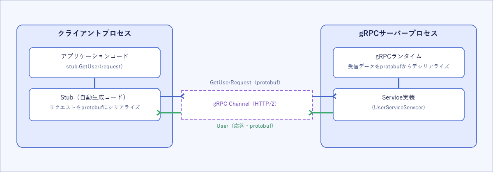
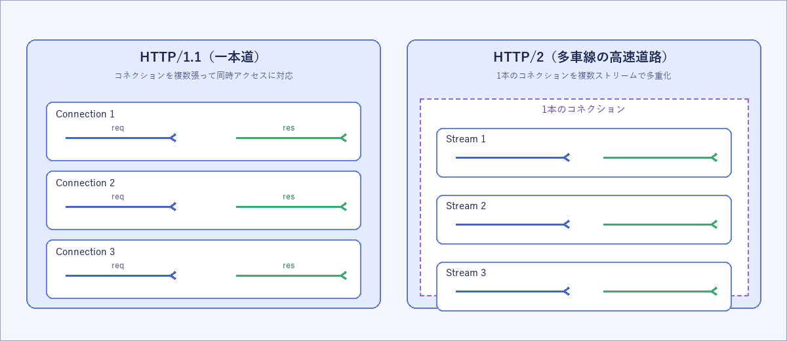
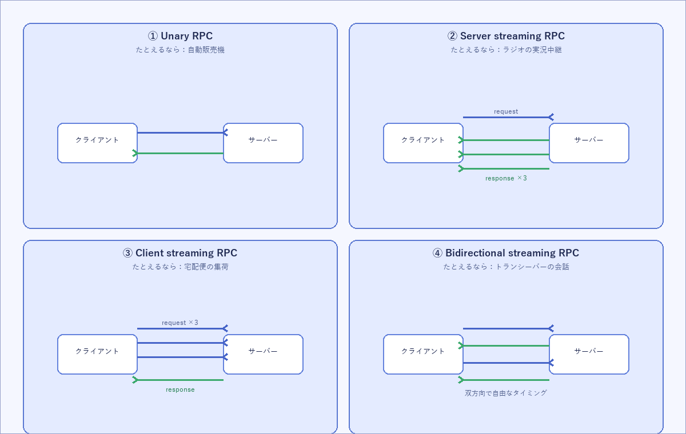

## はじめに

最近、Goでアプリケーション開発を行う中でgRPCに触れる機会があり、理解を整理する意味も込めて本記事を執筆しました。

マイクロサービス間の通信方式として広く使われているgRPC。「Protocol Buffersを使っていてRESTより速い」という程度の理解のまま、なんとなく使っている人も多いのではないでしょうか。

本記事では、身近な例えを交えながら、gRPCがなぜ速いのか、REST/JSONとは何が違うのか、4つの通信パターンはどう使い分けるのかを整理します。

---

## gRPCとは — たとえるなら「窓口越しの注文」

gRPCはGoogleが開発したオープンソースのRPC（Remote Procedure Call）フレームワークです。クライアントがまるでローカルのメソッドを呼ぶかのように、リモートサーバーの処理を呼び出せます。

イメージしやすいのは、市役所の窓口でのやり取りです。

```
  🧑 あなた                        🏢 窓口担当者（サーバー）
   │                                    │
   │ 「住民票をください」（リクエスト）   │
   ├───────────────────────────────────>│
   │                                    │  裏で書類を用意する
   │        「はい、どうぞ」（レスポンス）│  （実際の処理はサーバー側）
   │<───────────────────────────────────┤
```

あなたは窓口の裏でどんな処理が行われているか（書庫を探す、印刷する等）を知る必要はありません。「住民票をください」と頼めば結果が返ってくる、というインターフェースだけを意識すればいいのがRPCの考え方です。gRPCはこの「窓口でのやり取り」をネットワーク越しのプログラム間で実現する仕組みです。

gRPCの土台になっている技術は主に2つです。

- Protocol Buffers（protobuf）: メッセージの型とサービスのインターフェースを定義するIDL（Interface Definition Language）。バイナリ形式でシリアライズする
- HTTP/2: 通信プロトコル。多重化・ヘッダー圧縮・双方向ストリーミングを標準でサポートする

実際の通信では、クライアント側の「Stub」とサーバー側の「gRPCランタイム」が間に入り、アプリケーションコードの代わりにシリアライズやHTTP/2通信を肩代わりします。


*クライアントはStubを、サーバーはgRPCランタイムを介して通信する。protobufへのシリアライズ/デシリアライズはこの層が担う*

---

## REST/JSONとの違い — 「丁寧な手紙」か「レシートの商品コード」か

| 項目 | REST/JSON | gRPC |
|------|-----------|------|
| データ形式 | JSON（テキスト） | Protocol Buffers（バイナリ） |
| 通信プロトコル | 主にHTTP/1.1 | HTTP/2 |
| スキーマ定義 | OpenAPIなど（任意） | `.proto`ファイル（必須） |
| コード生成 | 別途ツールが必要 | protocから標準で生成 |
| ストリーミング | 非対応（SSE等で代替） | 標準でサポート（4パターン） |
| ブラウザからの直接利用 | ○ | △（grpc-webが必要） |
| 可読性 | 高い（人間が読める） | 低い（バイナリ） |

この違いは、手紙とレシートの違いに例えるとイメージしやすくなります。

```
【JSON：丁寧な手紙】                  【protobuf：レシートの商品コード】

  拝啓                                  #1  123
  お名前は 田中太郎 です。               #2  田中太郎
  メールアドレスは                       #3  taro@example.com
  taro@example.com です。
  敬具                                  （項目名は書かず、
                                          事前に決めた番号だけを送る）
  （毎回、項目名を律儀に書く）
```

JSONは `"name": "田中太郎"` のように毎回項目名（キー）を書くので人間には読みやすい一方、通信のたびに同じ文字列を送るぶん無駄が出ます。protobufはスーパーのレシートのように「あらかじめ決めた商品コード（フィールド番号）」だけをやり取りするので、送る情報量が小さくなります。その代わり、レシートの商品コード表（`.proto`ファイル）を知らない人が見ても中身が分からない、というトレードオフがあります。

---

## Protocol Buffersでスキーマを定義する

gRPCではまず `.proto` ファイルでメッセージとサービスを定義します。これが前述の「レシートの商品コード表」にあたります。

```protobuf
syntax = "proto3";

package user;

// メッセージ定義（＝レシートの商品コード表）
message GetUserRequest {
  string user_id = 1;
}

message User {
  string user_id = 1;  // コード#1
  string name = 2;     // コード#2
  string email = 3;    // コード#3
}

// サービス定義（＝窓口で受け付けるメニュー）
service UserService {
  rpc GetUser(GetUserRequest) returns (User);
}
```

各フィールドの末尾についている `1`, `2`, `3` が、そのままレシートの商品コードに相当するフィールド番号です。この番号がJSONに対する「軽さ」の正体の一つで、送信時はフィールド名の文字列ではなく番号（+型情報）だけが流れます。

この `.proto` ファイルを `protoc`（プロトコルバッファコンパイラ）に通すと、各言語向けのクライアント/サーバーのスタブコードが自動生成されます。

```bash
python -m grpc_tools.protoc \
  -I. --python_out=. --grpc_python_out=. \
  user.proto
```

生成されるのは、リクエスト/レスポンスのクラスと、サービスを呼び出す/実装するためのスタブです。開発者はビジネスロジックだけを書けばよく、シリアライズやネットワーク処理は生成コードとgRPCランタイムに任せられます。

---

## HTTP/2をベースにしている理由 — 「一本道」と「多車線の高速道路」

gRPCがHTTP/1.1ではなくHTTP/2を採用しているのには理由があります。

```
【HTTP/1.1：一本道】                  【HTTP/2：多車線の高速道路】

 🚗───🚙───🚕                          🚗┐
 （前の車が抜けるまで                   🚙┼─── 1本の道路（コネクション）を
   後ろの車は進めない）                 🚕┘     車線（ストリーム）分けして
                                              同時に走れる

 Conn1: ─req1─res1─                    Conn: ─┬─stream1: req1─res1
 Conn2: ─req2─res2─                          ├─stream2: req2─res2
 Conn3: ─req3─res3─                          └─stream3: req3─res3
（渋滞を避けるため                     （1本のコネクションで並列処理）
  道路（コネクション）を複数用意）
```

HTTP/1.1は基本的に「1本道」なので、複数のリクエストを同時にさばくにはコネクションを複数張るしかありませんでした。HTTP/2は1本のコネクションの中に複数の「車線（ストリーム）」を持てる多重化（Multiplexing）により、渋滞（Head-of-Lineブロッキング）を避けながら並行してやり取りできます。さらにヘッダー圧縮（HPACK）やバイナリフレーミングも組み合わさり、REST/HTTP1.1に比べてオーバーヘッドが小さくなります。

そしてHTTP/2が標準でサポートする双方向ストリーミングこそが、次に紹介する4つの通信パターンの土台になっています。


*HTTP/1.1はコネクションを複数張って並列化するが、HTTP/2は1本のコネクションを複数ストリームで多重化する*

---

## 4つの通信パターン — 日常のシーンで理解する

gRPCには用途に応じて4つの呼び出し方があります。それぞれ身近な場面に例えてみます。


*矢印の向きと本数で、リクエスト/レスポンスの流れ方の違いを比較できる*

### 1. Unary RPC — 「自動販売機」

```
  🧑 ──ボタンを押す──> 🥤 自動販売機
  🧑 <──缶ジュースが出る── 🥤 自動販売機
```

1回のリクエストに1回のレスポンスが返ってくる、一番シンプルな形です。自動販売機にボタン（リクエスト）を1回押すと、飲み物（レスポンス）が1本出てくるのと同じ感覚です。REST APIの基本的な呼び出しもこれに近い形です。

```protobuf
rpc GetUser(GetUserRequest) returns (User);
```

### 2. Server streaming RPC — 「ラジオの実況中継」

```
  🧑 ──「実況お願いします」──> 📻 放送局
  🧑 <──「1回表、A選手打席へ」── 📻
  🧑 <──「ヒット出ました！」──── 📻
  🧑 <──「2アウトです」──────── 📻
```

チャンネルを1回合わせれば、あとは放送局側が続報を送り続けてくれます。1回のリクエストに対し、サーバーが複数のレスポンスを時間差で返すパターンで、株価の更新通知やログ配信などサーバー側からのプッシュ型データ配信に向いています。

```protobuf
rpc WatchUserUpdates(GetUserRequest) returns (stream User);
```

### 3. Client streaming RPC — 「宅配便の集荷」

```
  🧑 ──荷物1個目──> 🚚 集荷ドライバー
  🧑 ──荷物2個目──> 🚚
  🧑 ──荷物3個目──> 🚚
  🧑 <──まとめて1枚の受領書── 🚚
```

荷物を渡すたびにいちいち受領書はもらわず、すべて渡し終えたタイミングでまとめて1枚の受領書を受け取ります。クライアントが複数のリクエストを送り続け、サーバーは最後に1回だけレスポンスを返すパターンで、ファイルのアップロードやセンサーデータの集約送信などに向いています。

```protobuf
rpc UploadUserBatch(stream User) returns (UploadSummary);
```

### 4. Bidirectional streaming RPC — 「トランシーバーでの会話」

```
  🧑 ──「聞こえますか、どうぞ」──> 📻 相手
  🧑 <──「聞こえます、どうぞ」──── 📻
  🧑 ──「では出発します」───────> 📻
  🧑 <──「了解、気をつけて」───── 📻
  （お互い好きなタイミングで話しかけられる）
```

電話やトランシーバーのように、どちらからでも好きなタイミングで話しかけられます。クライアントとサーバーが互いに独立したタイミングでメッセージを送受信し続けるパターンで、チャットアプリやリアルタイム翻訳など双方向のやり取りが必要な場面に向いています。

```protobuf
rpc Chat(stream ChatMessage) returns (stream ChatMessage);
```

---

## 簡単な実装イメージ（Python）

サーバー側の実装イメージです。`.proto` から生成された `UserServiceServicer` を継承してメソッドを実装します。窓口担当者（サーバー）の中身を実装するイメージです。

```python
import grpc
from concurrent import futures
import user_pb2
import user_pb2_grpc


class UserService(user_pb2_grpc.UserServiceServicer):
    def GetUser(self, request, context):
        return user_pb2.User(
            user_id=request.user_id,
            name="Taro Yamada",
            email="taro@example.com",
        )


server = grpc.server(futures.ThreadPoolExecutor(max_workers=10))
user_pb2_grpc.add_UserServiceServicer_to_server(UserService(), server)
server.add_insecure_port("[::]:50051")
server.start()
server.wait_for_termination()
```

クライアント側は、あたかもローカルのオブジェクトのメソッドを呼ぶような感覚で書けます。窓口に「住民票をください」と頼むだけで済むのと同じです。

```python
import grpc
import user_pb2
import user_pb2_grpc

channel = grpc.insecure_channel("localhost:50051")
stub = user_pb2_grpc.UserServiceStub(channel)

response = stub.GetUser(user_pb2.GetUserRequest(user_id="123"))
print(response.name)  # Taro Yamada
```

シリアライズ、コネクション管理、ストリーム制御はすべてgRPCランタイムが担うため、アプリケーションコードには通信の詳細が出てきません。

---

## モノリスからマイクロサービスへ — なぜgRPCなのか

### 関数呼び出しが「タダ」ではなくなる

モノリシックなアプリケーションでは、注文処理から在庫確認を呼ぶ処理は同一プロセス内の関数呼び出しです。

```python
def create_order(item_id, quantity):
    stock = inventory.check_stock(item_id)  # ただのメソッド呼び出し
    ...
```

このメソッド呼び出しは、

- メモリ上で完結し、ネットワークを経由しない（ナノ秒〜マイクロ秒オーダー）
- 引数や戻り値の型はコンパイラ・型チェッカーが保証してくれる

という2つの前提の上に成り立っています。ところがマイクロサービス化して `inventory` を別プロセス・別サーバーに切り出した瞬間、この関数呼び出しは丸ごとネットワーク越しの通信に置き換わります。今までタダだったものに、シリアライズのコスト・ネットワーク遅延・型の不一致リスクという請求書が新たに届くようなものです。

### モノリス分割で失う2つのものと、gRPCが取り戻すもの

| 失われるもの | モノリス（プロセス内） | REST/JSON分割後 | gRPC分割後 |
|---|---|---|---|
| 型の安全性 | コンパイラが保証 | 実行時までわからない（JSONは緩い型） | `.proto`でコンパイル時に検証、生成コードで型安全 |
| 呼び出し速度 | メモリ内（ns〜µs） | HTTP/1.1 + テキストパース | HTTP/2多重化 + バイナリシリアライズ |
| インターフェースの一貫性 | 同じコードベース内で共有 | OpenAPI等（維持は任意・手動） | `.proto`がSSOT（Single Source of Truth）になる |

たとえるなら、モノリスは「同じ会社の隣の部署に直接聞きに行く」ような状態です。共通言語（同じプログラミング言語・型システム）が通じるので、即座に正確な答えが返ってきます。

これをマイクロサービスに分割してREST/JSONで繋ぐと、「別会社に一般的な問い合わせフォームで質問を送る」ような状態になります。相手には届きますが、フォーマットが自由なぶん解釈のズレが起きやすく、やり取りにも時間がかかります。

gRPCでの分割は、「別会社だが、事前に取り交わした契約書（`.proto`）に基づく専用回線でやり取りする」状態に近いイメージです。相手が別会社（別プロセス）であることは変わりませんが、事前に交わした契約書のおかげでフォーマットの解釈違いが起きず、専用回線（HTTP/2 + protobuf）のおかげで速度も犠牲になりにくくなります。

### 呼び出し回数が多いサービス間ほど効いてくる

例えば「注文サービスが在庫サービスを1秒間に1000回呼ぶ」ようなケースを考えます。

- モノリス: 1000回の関数呼び出し。コストはほぼ無視できる
- マイクロサービス + REST/JSON: 1000回のHTTPリクエスト。JSONのパース・シリアライズとコネクションのオーバーヘッドが積み重なり、レイテンシが目に見えて増える
- マイクロサービス + gRPC: HTTP/2の多重化により1本のコネクション上で捌け、ペイロードもバイナリで軽量なため、モノリスに近い速度を維持しやすい

サービス間通信の頻度が高いシステムほど、「関数呼び出しに近い感覚を保ったままプロセスを分割したい」というニーズが強くなります。gRPCは、まさにこのニーズに応えるために設計された技術だと言えます。

---

## gRPCが向いているケース・向いていないケース

| 向いているケース | 向いていないケース |
|---|---|
| マイクロサービス間の内部通信 | ブラウザから直接叩くパブリックAPI |
| 高頻度・低レイテンシが要求される通信 | 人間がレスポンスを目視確認したいデバッグ用途 |
| ストリーミングでのデータ配信が必要 | 外部パートナー向けの汎用的なWeb API |
| 複数言語混在のサービス間で型を厳密に共有したい | クライアントの実装言語がgRPC非対応 |

社内の窓口同士（マイクロサービス間）ならお互いに「レシートの商品コード表（`.proto`）」を共有できますが、初めて来た一般のお客さん（外部のブラウザやパートナー）にコード表を渡して読み解いてもらうのは現実的ではありません。ブラウザは仕様上gRPCを直接扱えないため、Web公開APIとしてはRESTやGraphQLの方が扱いやすい場面が多いです（ブラウザから使う場合はgrpc-webというプロキシ層が必要になります）。一方でKubernetesクラスタ内のサービス間通信のように、実装側が言語・プラットフォームをコントロールできる場面ではgRPCの恩恵を受けやすくなります。

---

## まとめ

| 項目 | 内容 | たとえるなら |
|------|------|------|
| gRPCとは | Googleが開発したRPCフレームワーク | 窓口越しの注文 |
| データ形式 | Protocol Buffers（バイナリ、フィールド番号でシリアライズ） | レシートの商品コード |
| 通信プロトコル | HTTP/2（多重化・バイナリフレーミング） | 多車線の高速道路 |
| Unary | 1リクエスト・1レスポンス | 自動販売機 |
| Server streaming | 1リクエスト・複数レスポンス | ラジオの実況中継 |
| Client streaming | 複数リクエスト・1レスポンス | 宅配便の集荷 |
| Bidirectional streaming | 双方向で自由にやり取り | トランシーバーでの会話 |

gRPCの本質は「`.proto`でスキーマを一箇所に定義し、コード生成によって型安全なクライアント/サーバーを両言語間で共有する」という点にあります。REST/JSONの手軽さと引き換えに、型の厳密さと通信効率を取りに行くのがgRPCの立ち位置だと理解しておくと、採用可否の判断がしやすくなります。

---

## 参考リンク

- [gRPC公式サイト](https://grpc.io/)
- [Protocol Buffers公式ドキュメント](https://protobuf.dev/)
- [gRPC Python Quickstart](https://grpc.io/docs/languages/python/quickstart/)
