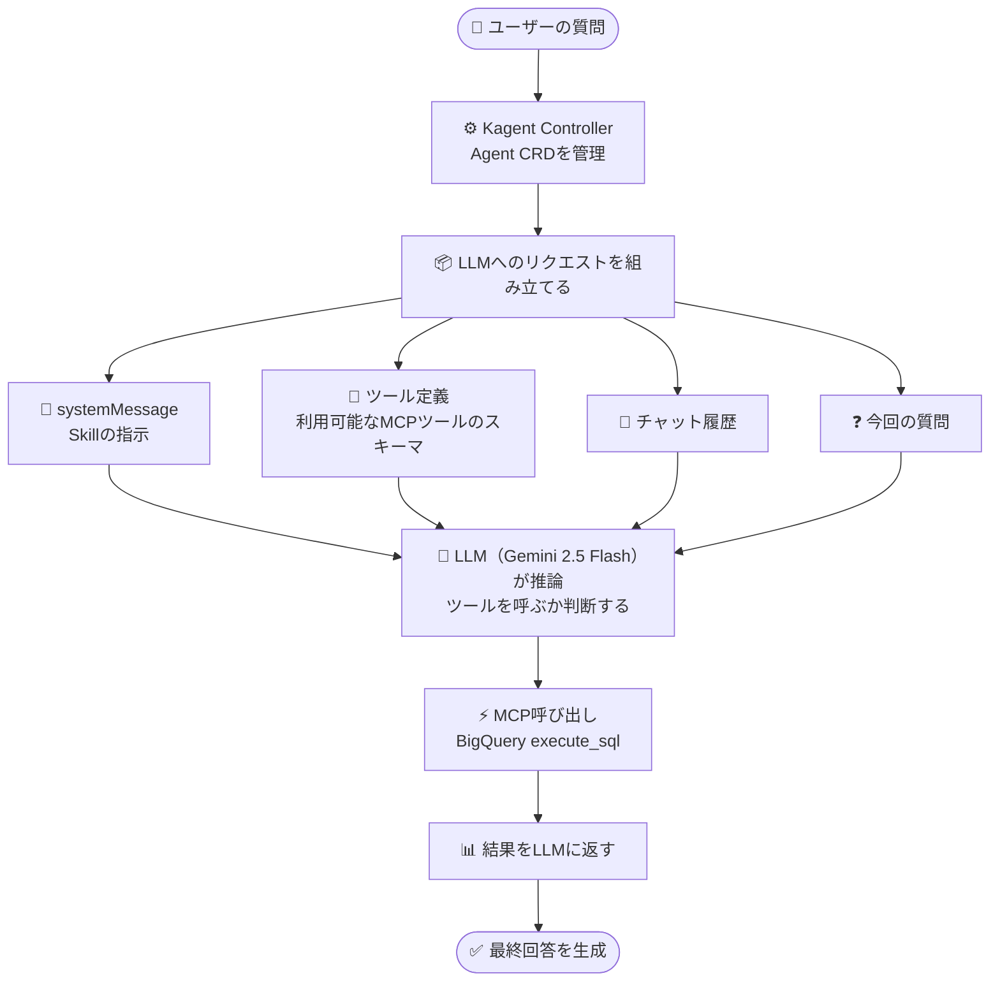

## はじめに

前回の記事ではGKE上にKagentをデプロイし、BigQuery MCPと連携して自然言語でデータ分析する構成を紹介しました。今回はその続きで、**コスト分析エージェントの運用中に気づいたトークン消費の問題**とその解決策を書きます。

具体的には「1リクエストあたり16万トークン消費」という状態を、**コンテキストエンジニアリング**によって8万トークンまで削減した話です。

:::message
本記事は前回の構成（GKE Autopilot + Kagent v0.8.6 + Gemini 2.5 Flash）を前提にしています。
:::

---

## Kagentのリクエスト処理フロー（おさらい）

コンテキストエンジニアリングの話をする前に、Kagentがどうリクエストを処理するかを整理しておきます。

Kagentのエージェントは以下の階層で構成されています。

```
Agent（CRD）
└── Skills（能力セット）
    ├── systemMessage（エージェントへの指示）
    └── Tools
        └── MCP呼び出し（BigQuery / kubectl など）
```

**Skills** はエージェントが持つ能力の単位です。1つのAgentに複数のSkillを割り当てることができ、各Skillに `systemMessage` とツール定義がセットになっています。

ユーザーから質問が来たときの処理の流れはこうなります。



### なぜ毎回コンテキストをまるごと送るのか

これはLLM APIの設計に起因しています。

GeminiやClaudeなどのLLMは**サーバーレス・ステートレスなAPIとして提供されています**。つまりAPIサーバー側はリクエストとリクエストの間に「会話の記憶」を一切持ちません。

```
ユーザー: 「先ほどの集計結果をもとに提案して」
    │
    ▼
LLM API（ステートレス）
    │ 「先ほど」って何のこと？何も覚えていない
    ▼
??? （会話の文脈がわからない）
```

そのためKagentは会話の文脈を**呼び出し側が毎回まるごと組み立てて送る**という設計をとっています。チャット履歴も、systemMessageも、ツール定義も、すべてリクエストのたびにゼロから積み上げます。

```
ユーザー: 「先ほどの集計結果をもとに提案して」
    │
    ▼
Kagent（ステートフルに履歴を管理）
    │ systemMessage + ツール定義 + 過去の会話履歴 + 今回の質問
    │ をまとめてリクエストに詰める
    ▼
LLM API（ステートレス）
    │ 渡されたコンテキストを見て推論
    ▼
「先ほどの集計では〜という結果でしたので、〇〇を提案します」
```

この設計の結果、**systemMessageは1回の呼び出しにつき1回カウントされ続けます**。会話が長くなればチャット履歴も膨らむため、トークン消費はターンを重ねるごとに増加します。

---

## なぜコンテキストエンジニアリングが重要なのか

コンテキストエンジニアリングの概念については以下の記事が参考になります。

https://qiita.com/yakumo_09/items/00ac034571fec150351a

### LLMエージェントのコストはコンテキストサイズで決まる

LLMのAPI課金は「入力トークン数 × 単価」が基本です。チャットUIで使うぶんには1リクエストの入力量はたかが知れていますが、**AIエージェントは1つの質問に答えるために複数回LLMを呼ぶ**ため、コンテキストが巨大になりやすい構造を持っています。

Kagentのエージェントが1回の推論ループで扱うコンテキストはおおよそこの構成です。

```
リクエストのコンテキスト
├── systemMessage（エージェントの指示）
├── ツール定義（利用可能なツールのスキーマ）
├── チャット履歴（直近数ターン分）
└── 今回のユーザー入力
```

このうち **systemMessageとツール定義は毎回固定で全量送られます**。ここが肥大化していると、質問内容に関係なく膨大なトークンを毎回消費することになります。

### マルチエージェント構成ではコストが掛け算になる

Kagentは1つのエージェントだけでなく、**スーパーバイザーエージェントが複数のサブエージェントを束ねるマルチエージェント構成**をとることができます。

```
ユーザーの質問
    │
    ▼
スーパーバイザーエージェント（LLM呼び出し①）
    ├── コスト分析エージェント（LLM呼び出し②）
    ├── セキュリティ監査エージェント（LLM呼び出し③）
    └── パフォーマンス監視エージェント（LLM呼び出し④）
```

この構成では、各エージェントの systemMessage が**それぞれ独立したリクエストのコンテキストに含まれます**。コスト分析エージェントのsystemMessageが8万文字あれば、そのエージェントが呼ばれるたびに8万文字分のトークンが消費され続けます。

シングルエージェントでも問題だったコストが、マルチエージェント構成に移行した瞬間に数倍に膨らむ——これがコンテキストエンジニアリングを後回しにできない理由です。

### ステートレスだからこそキャッシュ戦略が効く

毎回コンテキストをまるごと送る必要があるなら、「変わらない部分」のキャッシュを効かせることでコストを削減できます。GeminiやClaudeなどの最新モデルが提供する**プロンプトキャッシュ**がこの仕組みです。

仕組みはシンプルで、**リクエストのプレフィックス（先頭部分）が前回と一致していれば、その部分のトークン処理をスキップ**してキャッシュヒット扱いにします。キャッシュされたトークンは通常より大幅に安い単価で課金されます（Geminiの場合は約75%オフ）。

```
1ターン目のリクエスト
├── systemMessage（400文字）    ← 初回なのでフル処理
├── ツール定義（40,000トークン）← 初回なのでフル処理
├── チャット履歴（なし）
└── 今回の質問（500トークン）

2ターン目のリクエスト
├── systemMessage（400文字）    ← 前回と同じ → キャッシュヒット ✅
├── ツール定義（40,000トークン）← 前回と同じ → キャッシュヒット ✅
├── チャット履歴（1ターン分）   ← 追加されたので変化
└── 今回の質問（500トークン）   ← 変化する
```

キャッシュが効く条件は「コンテキストの**先頭から連続して**前回と一致していること」です。systemMessageとツール定義を先頭に固定し、変化する情報（履歴・質問）を末尾に置く——この順序を守ることがキャッシュ戦略の基本です。

ここで問題になるのがsystemMessageの肥大化です。

```
❌ キャッシュが機能しない状態
systemMessage（8万文字）
  └── セクションの中に「本日の日付: 2026/05/14」などが混入
      → 日付が変わるたびにキャッシュが無効化
      → 毎リクエスト8万文字分をフル処理

✅ キャッシュが機能する状態
systemMessage（400文字・固定）
  └── 変動する情報は含まない
      → 毎ターンキャッシュヒット
      → 2ターン目以降はほぼ無料
```

つまり**systemMessageを小さく・固定に保つことがキャッシュ戦略の前提**でもあります。いくらキャッシュの仕組みがあっても、8万文字のsystemMessageに動的な情報が混ざっていれば効果はゼロです。コンテキストを圧縮することとキャッシュを活かすことは、同じ目標に向かう両輪です。

### 「詳しく書けば精度が上がる」は思い込み

LLMエージェント開発でよくやりがちなのが、うまく動かないたびにsystemMessageに条件を追記し続けることです。

- エラーが出た → 「このエラーが出たら〇〇してください」を追加
- 回答がずれた → 「必ず〜の形式で答えてください」を追加
- 抜け漏れが出た → 「〜を忘れずに確認してください」を追加

これを繰り返すと手順書や例外ルールが際限なく積み上がっていきます。しかし実際には**LLMは長いコンテキストの中盤に書かれた指示を見落としやすい**（Lost in the Middle問題）ことが知られており、長くすれば精度が上がるわけではありません。むしろコストが増えながら品質が下がるという最悪の状態に陥ります。

コンテキストエンジニアリングは「どれだけ詳しく書くか」ではなく、**「LLMが必要な情報を必要なタイミングで受け取れるか」**を設計する技術です。

---

## 問題：1回のリクエストで16万トークンを消費していた

コスト分析エージェントを実際に使い始めると、Vertex AIの請求が予想より大きく膨らんでいることに気づきました。

調べてみると、**1回の質問で約16万トークンを消費**していました。

```
[Vertex AI コンソール]
Total tokens per request: ~160,000
  - Input tokens:  ~155,000   ← ほぼ全部これ
  - Output tokens: ~5,000
```

入力トークンがほとんどを占めています。これはシステムプロンプト（`systemMessage`）に大量のテキストを詰め込んでいたことが原因でした。

---

## 原因分析：systemMessageに詰め込みすぎていた

当初のエージェント定義はこんな状態でした。

```yaml
apiVersion: kagent.dev/v1alpha2
kind: Agent
metadata:
  name: cost-analyzer
  namespace: kagent
spec:
  declarative:
    modelConfig: default-model-config
    systemMessage: |
      あなたはKubernetesのコスト最適化エージェントです。
      以下のルールに従って回答してください。

      ## 基本方針
      - 必ず日本語で回答してください
      - 回答は必ずMarkdown形式で構造化してください
      - 数値データは必ずテーブル形式で表示してください
      - 専門用語には必ず説明を付けてください
      - 回答の最後には必ずまとめを付けてください
      - ユーザーの質問に直接答えた後、関連する追加情報も提供してください

      ## Namespace別コスト分析
      Namespace別のCPU・メモリ使用率を調査する際は以下の手順を取ってください。
      ステップ1: kubectl top pods --all-namespaces を実行してください
      ステップ2: 結果をNamespace別に集計してください
      ステップ3: CPU使用率が高い順にソートしてください
      ステップ4: 上位5Namespaceをテーブルで表示してください
      ステップ5: 各Namespaceについてリソースが多い理由を推測しコメントを追加してください
      ステップ6: コスト削減の提案を行ってください

      ## Pod別コスト分析
      Pod別のリソース使用状況を調査する際は以下の手順を取ってください。
      ステップ1: kubectl top pods -n {namespace} を実行してください
      ステップ2: CPU・メモリ使用率を確認してください
      ステップ3: リソースリクエストと実使用率を比較してください
      ステップ4: 過剰にリソースを確保しているPodを特定してください
      ステップ5: 最適なリソース設定を提案してください

      ## 長期稼働リソースの調査
      長期間稼働しているリソースを調査する際は以下の手順を取ってください。
      ステップ1: kubectl get pods --all-namespaces -o wide を実行してください
      ステップ2: 起動時刻からの経過時間を計算してください
      ステップ3: 7日以上稼働しているPodを一覧化してください
      ステップ4: それぞれのリソース使用率と合わせて表示してください

      ## 異常検知ルール
      以下のしきい値を超えた場合は必ず警告を出してください。
      - CPU使用率が80%を超えている場合: 「⚠️ CPU使用率が高い状態です」と表示してください
      - メモリ使用率が90%を超えている場合: 「⚠️ メモリ使用率が危険な水準です」と表示してください
      - リソースリクエストに対して実使用率が10%未満の場合: 「💡 リソースが過剰に確保されています」と表示してください
      - Podの再起動回数が5回を超えている場合: 「🔴 Podが不安定な状態です」と表示してください

      ## BigQueryコスト分析
      BigQueryのコストを分析する際は以下の手順を取ってください。
      ステップ1: INFORMATION_SCHEMA.JOBS_BY_PROJECT を参照してください
      ステップ2: 過去30日分のジョブを取得してください
      ステップ3: プロジェクト別・ユーザー別にスキャンバイト数を集計してください
      ステップ4: コストの高いクエリTOP10を表示してください
      ステップ5: 最適化の提案を行ってください

      ## 出力フォーマット
      必ずこの形式で回答してください：
      ### 概要
      （ここに調査結果の要点を2〜3文で書く）
      ### 調査結果
      （ここに詳細なデータをテーブルで表示する）
      ### 問題点
      （ここに検出された問題点を箇条書きで列挙する）
      ### 改善提案
      （ここにコスト削減のための具体的な提案を書く）
      ### 次のアクション
      （ここに推奨する次のステップを書く）

      ## 注意事項
      - kubectl コマンドを実行する場合は必ず --namespace または -n フラグを使ってください
      - データを削除するコマンドは実行しないでください
      - 本番環境に影響を与える変更は提案のみにとどめ、実行しないでください
      - エラーが発生した場合はエラーメッセージを表示してから別のアプローチを試みてください
      - 数値は必ず単位を付けて表示してください（例: 100m CPU、256Mi メモリ）
      - パーセンテージは小数点第1位まで表示してください
      - 日本語で回答してください
```

`systemMessage` の文字数を数えると **約8万文字**。エージェントへの全リクエストにこの巨大なシステムプロンプトが毎回送られるため、何を聞いても最初から8万トークン近く消費していた計算になります。

---

## コンテキストエンジニアリングとは

「コンテキストエンジニアリング」はLLMに渡すコンテキスト（プロンプト、ツール定義、履歴など）を**意図的に設計・最適化する技術**です。

プロンプトエンジニアリングがモデルへの「言い方」を工夫するのに対し、コンテキストエンジニアリングは**何をどれだけ渡すか**という情報設計の問題です。

主なアプローチはいくつかあります。

| アプローチ | 内容 |
|-----------|------|
| 不要情報の削除 | 実際に使われていないルール・例示を取り除く |
| 密度の向上 | 長い説明文を短い宣言文に書き換える |
| 動的ロード | 常時送らず、必要なときだけツールや情報を渡す |
| 構造化 | LLMが処理しやすい形式（箇条書きなど）に統一する |

今回は主に「不要情報の削除」と「密度の向上」で対応しました。

---

## やったこと：systemMessageを圧縮する

### Before：命令を手続きで書いていた

削減前のシステムプロンプトは「こうなったらこうしろ」という手続き的な記述が中心でした。

```
## Namespace別コスト分析
Namespace別のCPU・メモリ使用率を調査する際は以下の手順を取ってください。
ステップ1: kubectl top pods --all-namespaces を実行してください
ステップ2: 結果をNamespace別に集計してください
ステップ3: CPU使用率が高い順にソートしてください
ステップ4: 上位5Namespaceをテーブルで表示してください
ステップ5: 各Namespaceについてリソースが多い理由を推測しコメントを追加してください
ステップ6: コスト削減の提案を行ってください
```

### After：目標と制約だけを宣言する

LLMはすでに「どうすればNamespaceごとのコストを調べられるか」を知っています。手順を教える必要はなく、**何を達成してほしいかと守ってほしい制約だけを書く**に切り替えました。

```
## Namespace別コスト分析
CPU・メモリ使用率をNamespace別に集計し、上位5件をテーブルで表示すること。
コスト削減の提案を含めること。
```

6行の手順書が2行の宣言文になりました。

### 具体的な削減ポイント

**① ステップバイステップの手順書を削除**

LLMは適切なツールさえ持っていれば、自分で手順を組み立てられます。手順書はむしろ推論を制約することがあります。

```
# Before：ツールの使い方まで指示していた
kubectl top podsを実行するときは必ず--all-namespacesフラグを付けてください。
Namespaceごとに集計し、CPU使用率の高い順に並べてください。
結果は必ずMarkdownテーブルに変換してから表示してください。

# After：何を返してほしいかだけを書く
Namespace別のCPU/メモリ使用率を集計し、テーブルで表示すること。
```

**② 重複・冗長な記述を統合**

「日本語で答えてください」という指示がセクションごとに計7箇所に散在していました。1箇所にまとめました。

```
# Before（各セクションの末尾に繰り返し書いていた）
## Namespace別コスト分析
...（手順）...
※ 必ず日本語で回答してください

## Pod別コスト分析
...（手順）...
※ 必ず日本語で回答してください  ← また書いてある

# After（冒頭に1回だけ）
調査結果は日本語で報告すること。
```

**③ 出力フォーマット定義を簡略化**

5段階の厳密なフォーマット定義（`### 概要` → `### 調査結果` → `### 問題点` → `### 改善提案` → `### 次のアクション`）は、現実の回答をテンプレートに押し込んで質を下げることがあります。「構造化して返す」という指示に変えました。

```
# Before：厳密なフォーマット指定
## 出力フォーマット
必ずこの形式で回答してください：
### 概要
（ここに調査結果の要点を2〜3文で書く）
### 調査結果
（ここに詳細なデータをテーブルで表示する）
...

# After：方針だけ示す
数値データはテーブル形式、分析コメントは箇条書きで簡潔にまとめること。
```

**④ しきい値ルールをPrometheusに移す**

「CPU80%超えで警告」のようなアラートルールはシステムプロンプトではなく、Prometheusのアラートルール（`PrometheusRule` CRD）で管理するのが正しい場所です。

```yaml
# Before：systemMessageに閾値を書いていた
systemMessage: |
  CPU使用率が80%を超えている場合: 「⚠️ CPU使用率が高い状態です」と表示してください
  メモリ使用率が90%を超えている場合: 「⚠️ メモリ使用率が危険な水準です」と表示してください
  ...

# After：PrometheusRuleに移す
apiVersion: monitoring.coreos.com/v1
kind: PrometheusRule
metadata:
  name: cost-alerts
spec:
  groups:
  - name: cost
    rules:
    - alert: HighCpuUsage
      expr: container_cpu_usage_seconds_total > 0.8
      annotations:
        summary: "CPU使用率が高い状態です"
```

---

## 削減後のsystemMessage

```yaml
apiVersion: kagent.dev/v1alpha2
kind: Agent
metadata:
  name: cost-analyzer
  namespace: kagent
spec:
  declarative:
    modelConfig: default-model-config
    systemMessage: |
      あなたはKubernetesクラスターのコスト最適化エージェントです。
      以下の観点でリソース使用状況を調査し、日本語で報告してください。
      数値データはテーブル形式、分析コメントは箇条書きで簡潔にまとめること。

      調査観点：
      - Namespace・Pod別のCPU/メモリ使用率
      - リソースリクエストに対する実使用率の乖離
      - 長期間稼働しているが利用されていない可能性があるリソース
    tools:
    - type: McpServer
      mcpServer:
        name: bigquery-mcp
        kind: RemoteMCPServer
        toolNames:
        - execute_sql
```

**systemMessageの文字数：8万文字 → 約400文字**（約95%削減）

---

## 結果：トークン消費が16万→8万に

```
[削減後のVertex AI コンソール]
Total tokens per request: ~80,000
  - Input tokens:  ~75,000
  - Output tokens: ~5,000
```

入力トークンが約半分になりました。システムプロンプトを400文字に圧縮しただけでこれだけ変わります。

残りの7.5万トークンの内訳はこうなっています。

| 内訳 | トークン数 | 備考 |
|------|-----------|------|
| ツール定義（BigQuery MCP） | ~40,000 | execute_sql のスキーマ |
| チャット履歴 | ~30,000 | 直近数ターン分 |
| 今回の質問 | ~5,000 | |
| システムプロンプト | ~400 | 削減後 |

ツール定義がまだ大きいため、ここが次の削減候補です。

---

## 副次効果：回答の質も上がった

トークンを減らすだけでなく、**回答の質も改善**されました。

手順書でがんじがらめにしていたときは、エージェントが指示に引きずられて不自然な回答をするケースがありました。目標と制約だけを渡したほうが、エージェントが状況に応じて適切な判断をしやすいようです。

---

## まとめ

| 指標 | Before | After |
|------|--------|-------|
| systemMessage文字数 | ~8万文字 | ~400文字 |
| 入力トークン/リクエスト | ~155,000 | ~75,000 |
| 合計トークン/リクエスト | ~160,000 | ~80,000 |
| コスト | 約2倍 | ベースライン |

コンテキストエンジニアリングのポイントをまとめると：

- **LLMが知っていることは書かない**（手順書は不要、目標だけ渡す）
- **制約は最小限に**（冗長な繰り返しを1箇所にまとめる）
- **ルールはツール定義やアラート側に持たせる**（システムプロンプトに集中させない）
- **出力フォーマットは緩く定義する**（厳格な型より方針を示す）

Kagentのようにシステムプロンプトが毎回送られるアーキテクチャでは、ここの最適化がそのままコストに直結します。「とりあえず詳しく書けば精度が上がる」という思い込みを捨てて、コンテキストの設計を意識してみると思わぬ効果があります。

---

## 参考リンク

- [Kagent公式サイト](https://kagent.dev/)
- [GitHub — kagent-dev/kagent](https://github.com/kagent-dev/kagent)
- [Vertex AI — 料金](https://cloud.google.com/vertex-ai/pricing)
