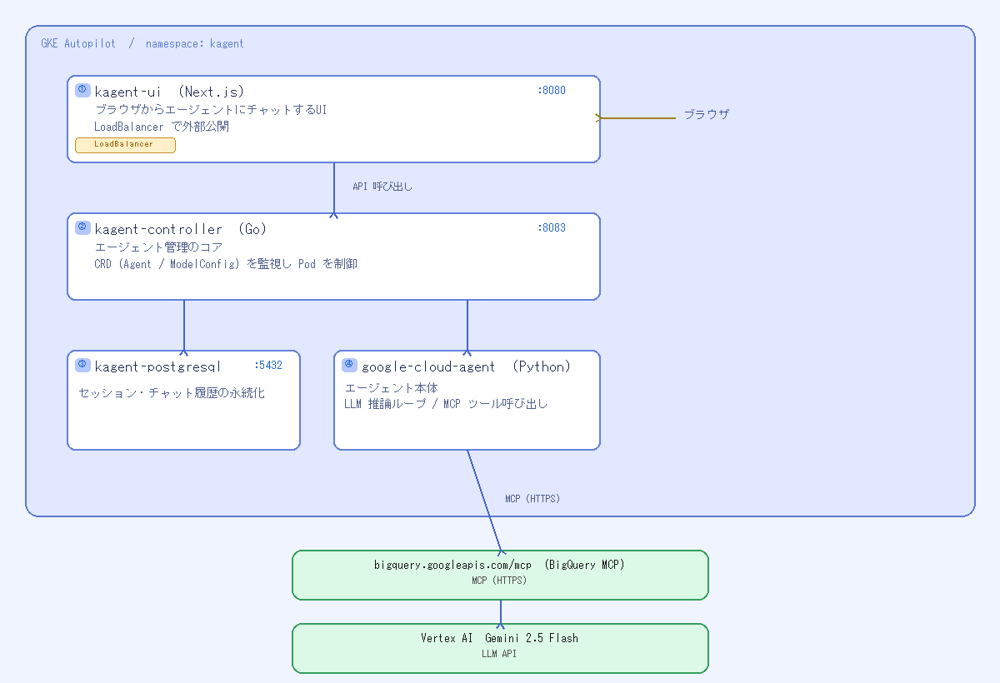
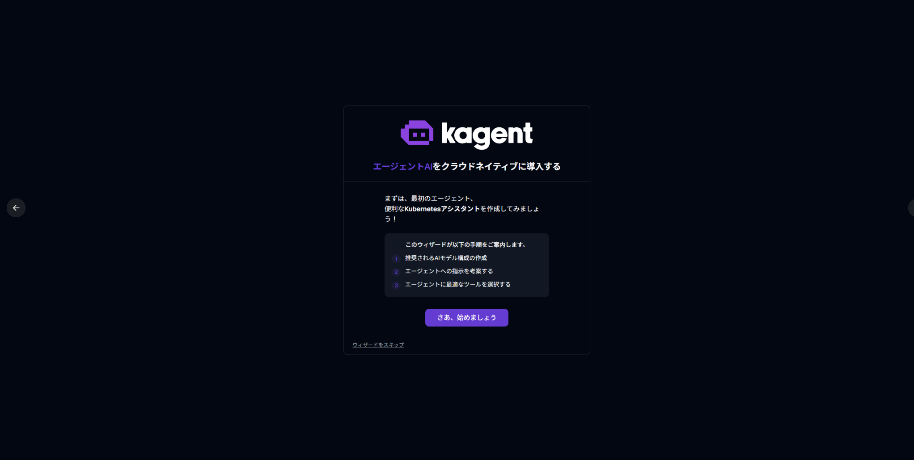
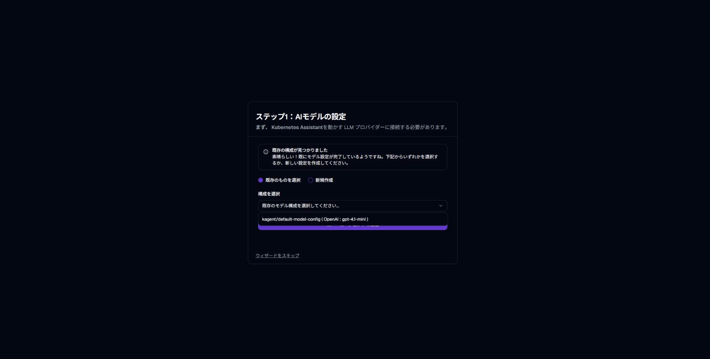
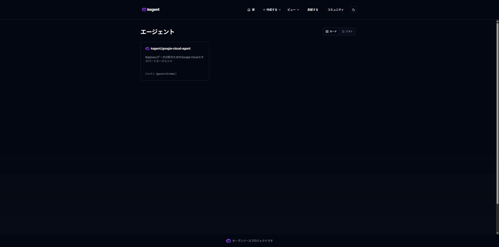
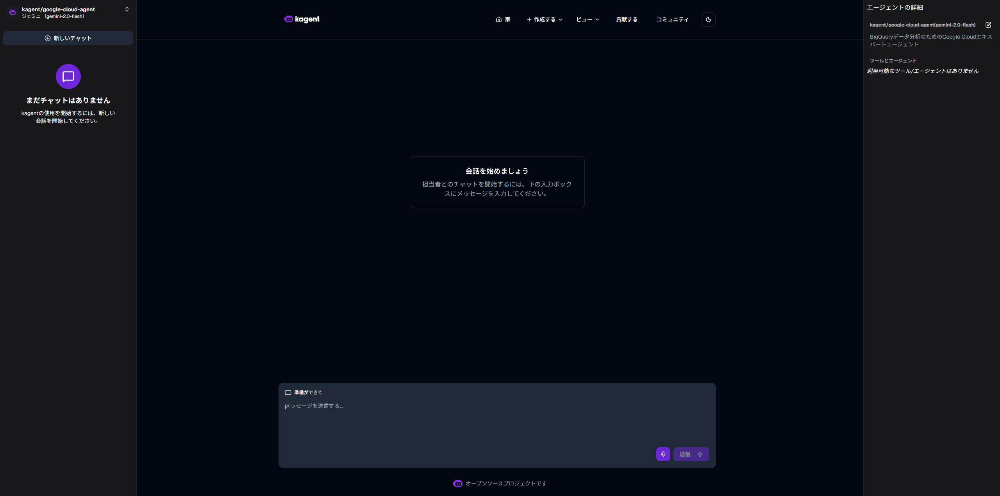
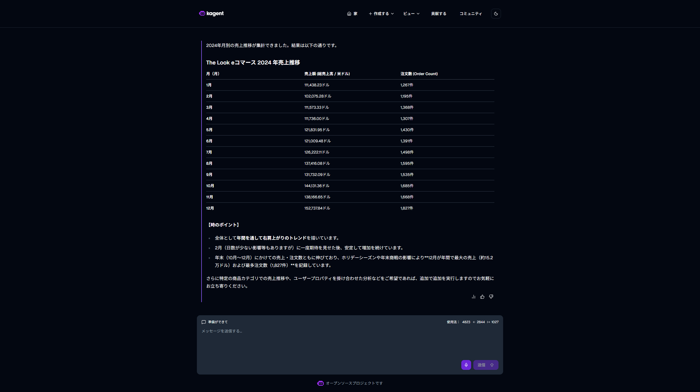

## はじめに

前回の記事ではKagentの概要を紹介しました。今回は実際にGKE Autopilot上にKagentをデプロイし、BigQuery MCPサーバー経由で自然言語データ分析ができるまでを動かしてみた記録です。

構成をひと言で表すと「Kubernetesが自然言語でBigQueryに問い合わせられるようになる」です。

:::message
本記事はGKE AutopilotでのKagent v0.8.6の検証記録です。一部のハマりポイントや回避策も含めて正直に書いています。
:::

---

## 構成概要

| 項目 | 値 |
|------|------|
| GKEモード | Autopilot |
| Kagentバージョン | 0.8.6 |
| LLM | Gemini 2.5 Flash（Vertex AI） |
| MCPサーバー | BigQuery Managed Remote MCP |
| データセット | bigquery-public-data.thelook_ecommerce |
| インフラ管理 | Terraform |

全体の流れはざっくりこうなります。

```
ブラウザ
  └──→ kagent-controller（GKE内）
          └──→ BigQuery MCP（bigquery.googleapis.com/mcp）
                  └──→ Vertex AI Gemini 2.5 Flash
```

---

## なぜGKE Autopilotを選んだか

KagentはKubernetes上で動くので、まずクラスターを用意する必要があります。Standard（ノード自分で管理）とAutopilot（フルマネージド）で迷いましたが、検証目的なのでAutopilotを選びました。

| 比較 | Standard | Autopilot |
|------|----------|---------------|
| ノード管理 | 手動 | 自動（Googleがノードをプロビジョニング） |
| コスト | ノード固定課金 | Podのリソース使用量のみ課金 |
| セキュリティ設定 | 要設定 | デフォルトで強化済み |
| 学習コスト | 高い | 低い |

検証・学習目的ならAutopilotが断然ラクでした。使っていないときはコストもほぼ発生しません。

### GKE Autopilotの仕組み

StandardとAutopilotで何が変わるのかを図で整理します。

Standard（通常モード）

```
あなたが管理する範囲
┌─────────────────────────────────────────────────────┐
│                                                      │
│  Node（e2-standard-4）  Node（e2-standard-4）        │
│  ┌──────────────────┐  ┌──────────────────┐         │
│  │ Pod  Pod  Pod    │  │ Pod  Pod         │         │
│  └──────────────────┘  └──────────────────┘         │
│                                                      │
│  ※ ノードのスペック・台数・OSパッチを自分で決める    │
│  ※ Podが少なくてもノード分の課金が発生する          │
└─────────────────────────────────────────────────────┘
```

Autopilot（フルマネージドモード）

```
あなたが管理する範囲
┌──────────────────────────┐
│                           │
│  Pod  Pod  Pod            │  ← Podを宣言するだけ
│  （必要なリソースを指定）  │
└──────────┬───────────────┘
           │ kubectl apply
           ▼
┌──────────────────────────────────────────────────────┐
│  Google が自動で管理する範囲                           │
│                                                       │
│  ┌─────────────────────────────────────────────┐    │
│  │  Node（自動プロビジョニング）                 │    │
│  │                                              │    │
│  │  ┌─────────┐  ┌─────────┐  ┌─────────┐    │    │
│  │  │  Pod    │  │  Pod    │  │  Pod    │    │    │
│  │  │cpu:500m │  │cpu:500m │  │cpu:500m │    │    │
│  │  │mem:1Gi  │  │mem:1Gi  │  │mem:1Gi  │    │    │
│  │  └─────────┘  └─────────┘  └─────────┘    │    │
│  │                                              │    │
│  │  Podがなくなればノードも自動削除              │    │
│  └─────────────────────────────────────────────┘    │
│                                                       │
│  ※ ノードのスペック・台数・OSパッチはGoogleが管理     │
│  ※ 課金はPodのリソース要求量のみ（ノード単位ではない）│
└──────────────────────────────────────────────────────┘
```

Autopilotでは「どんなPodを動かしたいか」だけを宣言すれば、ノードの調達・スケーリング・セキュリティパッチはすべてGoogleが面倒を見てくれます。Podがゼロになればノードも消えるので、夜間や週末にコストがかかりません。

---

## ネットワーク設計

セキュリティのベストプラクティスに従い、Private Nodesを採用しました。

```
Private Node ──→ Cloud NAT ──→ Internet（コンテナイメージ取得など）
Private Node ──→ Private Google Access ──→ BigQuery API（直接・NAT不要）
```

### サブネット設計

| 用途 | CIDR | 上限数 | 理由 |
|------|------|--------|------|
| Node | 10.0.0.0/24 | 256台 | 検証環境なので/24で十分 |
| Pod | 10.1.0.0/16 | 65,536個 | ノード1台あたり最大110 Pod × 最大ノード数を考慮 |
| Service | 10.2.0.0/20 | 4,096個 | ClusterIPの数は通常Podより少ないので/20 |
| GKEコントロールプレーン | 172.16.0.0/28 | 16台 | GKEが要求する最小サイズ（/28固定） |

#### PodレンジはノードのIP消費量から逆算する

GKEではノード1台ごとにPod用のIPブロックがまとめて払い出されます。

```
ノード1台 = /24 ブロック（256 IP）を占有
　→ 実際に使えるPod数は最大110個（GKEの上限）
　→ 残りのIPは予約・ルーティング用に消費される
```

つまりノード数 × 256 IP分のレンジが必要です。

```
例: ノード最大10台の場合
  10台 × 256 = 2,560 IP → /20（4,096 IP）でギリギリ
  余裕を持たせて /16（65,536 IP）にしておくのが無難
```

今回は検証環境なのでそこまでノードは増えませんが、後からPodレンジを変更するとクラスター再作成が必要になるため、最初から /16 にしておきました。

#### Serviceレンジは/20で足りる

KubernetesのServiceはDeploymentほど数が増えないので /20（4,096個）で十分です。ただしこちらも変更にはクラスター再作成が伴うため、小さくしすぎないようにしています。

Terraform では `private_ip_google_access = true` を設定しておくと、BigQuery APIへの通信はCloud NATを介さずプライベートアドレスで届きます。これはちょっとハマりポイントで、最初設定し忘れてBigQuery疎通に詰まりました。

```hcl
resource "google_compute_subnetwork" "kagent" {
  ip_cidr_range            = "10.0.0.0/24"
  private_ip_google_access = true  # BigQuery APIへのプライベートアクセスに必要

  secondary_ip_range {
    range_name    = "pods"
    ip_cidr_range = "10.1.0.0/16"
  }
  secondary_ip_range {
    range_name    = "services"
    ip_cidr_range = "10.2.0.0/20"
  }
}
```

---

## GKEクラスター構成（Terraform）

```hcl
resource "google_container_cluster" "kagent" {
  name             = "kagent-cluster"
  location         = "asia-northeast1"
  enable_autopilot = true

  private_cluster_config {
    enable_private_nodes    = true
    enable_private_endpoint = false  # ローカルからkubectlを使いたいので公開
    master_ipv4_cidr_block  = "172.16.0.0/28"
  }

  ip_allocation_policy {
    cluster_secondary_range_name  = "pods"
    services_secondary_range_name = "services"
  }
}
```

`enable_private_endpoint = false` にしておくとコントロールプレーンのAPIサーバーだけパブリックアドレスを持つので、ローカルから `kubectl` が使えます。ノード自体はプライベートIPのままです。

---

## Kagentコンポーネントの全体像

GKEにデプロイした後、`kagent` ネームスペース内には以下のPodが起動します。



それぞれの役割をまとめると：

| Pod | 役割 |
|-----|------|
| ① kagent-ui | ブラウザ向けチャットUI（Next.js）。LoadBalancerで外部公開 |
| ② kagent-controller | CRDを監視してAgentのライフサイクルを管理するコア |
| ③ kagent-postgresql | チャット履歴・セッション情報の永続化 |
| ④ google-cloud-agent | エージェント本体。LLMの推論ループを回しBigQuery MCPを呼ぶ |

---

## KagentのHelmデプロイ

Kagentはv0.8.6からHelmのOCIレジストリ（GHCR）で配布されています。CRDを先にインストールする必要があります。

```bash
# 1. CRDを先にインストール（順番を守らないとエラーになります）
helm upgrade --install kagent-crds \
  oci://ghcr.io/kagent-dev/kagent/helm/kagent-crds \
  --version 0.8.6 --namespace kagent --create-namespace

# 2. kagent本体
helm upgrade --install kagent \
  oci://ghcr.io/kagent-dev/kagent/helm/kagent \
  --version 0.8.6 --namespace kagent \
  -f helm-values.yaml
```

### Helm Values（主要部分）

```yaml
providers:
  default: gemini
  gemini:
    provider: Gemini
    model: "gemini-2.5-flash"

ui:
  enabled: true
  service:
    type: LoadBalancer  # 外部からUIにアクセスできるよう公開

controller:
  agentDeployment:
    serviceAccountName: kagent-agent  # Workload Identity用のKubernetes SA
```

今回はVertex AIのGemini 2.5 FlashをLLMとして使いました。GKE上から使うのでAPIキー不要でWorkload Identityで認証できるのが楽な点です。

### L4ロードバランサーを選んだ理由

`type: LoadBalancer` を指定すると、GKEはデフォルトで**L4（TCP）のネットワークロードバランサー**をプロビジョニングします。L7（HTTP）のApplication Load BalancerにするにはIngressやGateway APIが別途必要になります。

今回L4を選んだ主な理由はKagentがSSE（Server-Sent Events）を使って応答をストリーミングするためです。

| | L4（今回） | L7 |
|---|---|---|
| プロトコル | TCP をそのまま転送 | HTTP として解釈 |
| SSE/ストリーミング | 問題なし | バッファリングやタイムアウトが発生しやすい |
| 設定コスト | `type: LoadBalancer` だけ | Ingress + アノテーション設定が必要 |
| SSL終端 | Pod側で対応 | LB側で対応可能 |

L7ロードバランサーはHTTPレイヤーでレスポンスをバッファリングすることがあり、SSEのようなチャンク転送では接続が途中で詰まるケースがあります。L4であればTCPをそのままPodに流すだけなのでストリーミングとの相性が良く、検証環境には十分な選択でした。

---

## BigQuery MCP連携

### RemoteMCPServerの設定

Google CloudはBigQueryのManaged Remote MCPサーバーを提供しています。エンドポイントは `https://bigquery.googleapis.com/mcp` です。

```yaml
apiVersion: kagent.dev/v1alpha2
kind: RemoteMCPServer
metadata:
  name: bigquery-mcp
  namespace: kagent
spec:
  url: "https://bigquery.googleapis.com/mcp"
  headers:
    Authorization:
      secretKeyRef:
        name: kagent-bigquery-token
        key: token
```

### Agentマニフェスト

```yaml
apiVersion: kagent.dev/v1alpha2
kind: Agent
metadata:
  name: google-cloud-agent
  namespace: kagent
spec:
  declarative:
    modelConfig: default-model-config
    deployment:
      env:
      - name: GOOGLE_GENAI_USE_VERTEXAI
        value: "1"
      - name: GOOGLE_CLOUD_PROJECT
        value: "your-project-id"
      - name: GOOGLE_CLOUD_LOCATION
        value: "global"
      - name: GOOGLE_GENAI_THINKING_BUDGET
        value: "0"    # thinking tokensを無効化（後述）
    systemMessage: |
      You are a Google Cloud expert agent.
      You can query BigQuery using MCP tools.
      Always respond in Japanese.
    tools:
    - type: McpServer
      mcpServer:
        name: bigquery-mcp
        kind: RemoteMCPServer
        toolNames:
        - execute_sql
```

---

## 認証設計

### Workload Identity（Vertex AI用）

GKE PodからVertex AIへのアクセスはWorkload Identityで安全に行えます。

```
kagent Pod
  │（Kubernetes SA: kagent/kagent-agent）
  │
  ↓ Workload Identity
GCP Service Account: kagent-agent@{project}.iam.gserviceaccount.com
  │
  ├── roles/aiplatform.user      （Vertex AI使用）
  ├── roles/bigquery.user        （BigQueryジョブ実行）
  └── roles/bigquery.dataViewer  （データ読み取り）
```

```hcl
resource "google_service_account_iam_member" "workload_identity" {
  service_account_id = google_service_account.kagent_agent.name
  role               = "roles/iam.workloadIdentityUser"
  member             = "serviceAccount:${var.project_id}.svc.id.goog[kagent/kagent-agent]"
}
```

### BigQuery MCPトークン（ここがハマりポイント）

BigQuery Managed Remote MCPの認証に `mcp.tools.call` という権限が必要なのですが、この権限はプロジェクトオーナー権限を持つアカウントにしか付与できません。つまりWorkload IdentityのService Accountには付与できないのです。

そのため、個人のOAuthトークンをKubernetes Secretに格納し、CronJobで30分ごとに更新する暫定対応を取りました。

```bash
# CronJobが30分ごとに実行する処理
gcloud auth print-access-token \
  | kubectl create secret generic kagent-bigquery-token \
      --from-literal=token="Bearer $(cat /dev/stdin)" \
      --dry-run=client -o yaml | kubectl apply -f -
```

この点は将来的にGoogle側の対応で改善されることを期待しています。

---

## Kagentにアクセス

デプロイが完了したら、LoadBalancerのIPアドレスでブラウザからアクセスできます。

```bash
kubectl get svc -n kagent kagent-ui
# EXTERNAL-IP の列に表示されるIPアドレス:8080 にアクセス
```

### Step 1: ウィザードをスキップする

初回アクセスすると「最初のエージェントを作成しましょう」というウィザードが表示されます。



ウィザードを進めると「ステップ1：AIモデルの設定」でデフォルトモデルとして OpenAI gpt-4.1-mini が表示されます。今回はGeminiをHelmで設定済みなので、このウィザードは使いません。画面下部の「ウィザードをスキップ」をクリックします。



:::message
ウィザードはKubernetes Assistantエージェントを新規作成するフローです。今回はHelmのValuesでGemini設定済みのBigQueryエージェントをマニフェストで直接デプロイしているので、ウィザードは不要です。
:::

### Step 2: エージェントを選択する

スキップするとエージェント一覧が表示されます。Helmデプロイ後にマニフェストで適用した `kagent/google-cloud-agent` が表示されているので、これをクリックします。



### Step 3: チャット画面で質問する

google-cloud-agentのチャット画面が開きます。左上に gemini-2.0-flash と表示されており、Geminiで動いていることが確認できます。



テキストボックスに質問を入力して送信します。

```
thelook_ecommerce の2024年月別注文数を教えて
```

### Step 4: BigQuery MCP が自動でSQLを実行して回答

しばらくするとエージェントがBigQuery MCPを通じてSQLを実行し、結果を自然言語でまとめて返してくれます。



月別の売上金額・注文数の表に加え、「夏にかけて売上が上がるトレンド」「8月が最も件数が多い」といった分析コメントまで自動で生成してくれました。SQLを一切書かずにBigQueryのデータを分析できるのが確認できました。

---

## ディレクトリ構成（参考）

```
kagent-training/
├── terraform/
│   ├── environments/dev/              # 変数・バックエンド設定
│   └── modules/
│       ├── network/                   # VPC / Subnet / Cloud NAT
│       ├── gke/                       # GKE Autopilotクラスター
│       ├── iam/                       # SA / Workload Identity
│       └── kagent/                    # Helmデプロイ（CRD → kagent）
└── kubernetes/
    ├── agents/
    │   └── google-cloud-agent.yaml    # BigQuery MCPエージェント定義
    └── mcp/
        └── bigquery-mcp.yaml          # RemoteMCPServer + Token CronJob
```

---

## まとめ

GKE Autopilot上にKagentをデプロイし、BigQuery MCPと連携させることで自然言語でBigQueryを分析する構成を実現できました。

よかった点：
- GKE AutopilotはKubernetes初心者でもノード管理不要で楽
- TerraformでVPC・GKE・IAMをコードで管理できるので再現性が高い
- Workload IdentityでVertex AIへの認証がシンプルに解決できた

課題点：
- BigQuery MCP専用の権限（`mcp.tools.call`）がSAに付与できないため、OAuthトークンのCronJob更新が必要

KagentはCNCFサンドボックスになったばかりのプロジェクトなので、まだ荒削りな部分もありますが、「KubernetesにAIエージェントを宣言的に管理する」というコンセプトは非常に面白いと思います。

---

## 参考リンク

- [Kagent公式サイト](https://kagent.dev/)
- [GitHub — kagent-dev/kagent](https://github.com/kagent-dev/kagent)
- [BigQuery Managed Remote MCP — Google Cloud](https://cloud.google.com/bigquery/docs/mcp)
- [GKE Autopilot — Google Cloud](https://cloud.google.com/kubernetes-engine/docs/concepts/autopilot-overview)
- [Workload Identity — Google Cloud](https://cloud.google.com/kubernetes-engine/docs/how-to/workload-identity)
